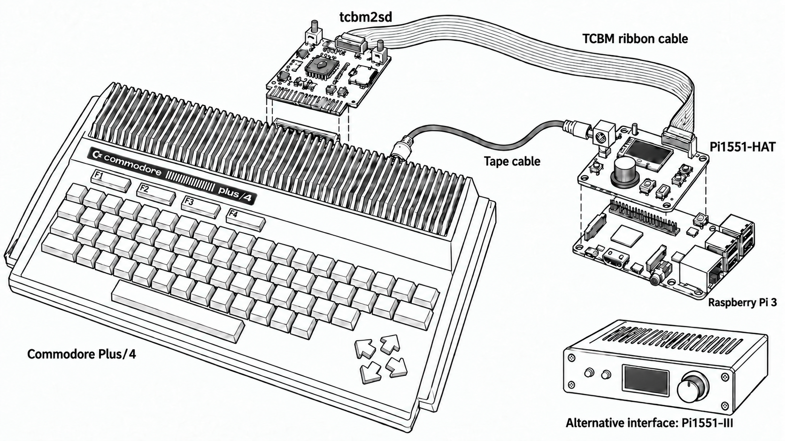

# Pi1551

Pi1551 is a Commodore 1551 drive emulator for the Commodore C16, C116, and
Plus/4 family, authored by Maciej Witkowiak. It is based on Stephen White's
[Pi1541](https://cbm-pi1541.firebaseapp.com/) bare-metal Raspberry Pi project,
but this fork replaces the IEC/1541 target with a TCBM/1551 target.

Pi1551 has two independent jobs. For disk use, it needs a tcbm2sd paddle plus
a ribbon cable to a PI1551-hat or PI1551-III; in that setup the tcbm2sd board
is only the Commodore-side TCBM electrical interface, and its own SD-card 1551
simulator is disabled. Unplug the ribbon cable and the tcbm2sd board works
again as a standalone SD-card device. Separately, Pi1551 can be used as a TAP
player through the tape port only, without the TCBM ribbon cable.

## Main Features

- Cycle-exact Commodore 1551 emulation for D64 and G64 disk images.
- G64-only preservation of SuperDOS 1551 non-standard formatting, including
  per-track density changes that current YaPe/VICE releases do not handle
  correctly when formatting disks.
- File-level SD card access over TCBM, similar in spirit to SD2IEC/tcbm2sd
  browser mode (including direct `LOAD` of `.prg` files without emulation).
- SOLO/LIST media selection, mixed-format fliplists and `.lst` loading.
- `.prg` files can be mounted as read-only virtual one-file disks without
  starting drive emulation; ordinary Commodore `LOAD` remains direct SD access.
- Read-only file-level access to files inside D71, D81, D80, and D82 images.
- C16/C116/Plus/4 TAP playback and recording through the tape port. Matching
  IDX files let you jump directly to individual files on a tape and are created
  or updated automatically when recording a recognized Plus/4 `SAVE`.
- Eight-row I2C OLED browser/menu with rotary encoder, Insert and Back controls.
- Runtime drive, tape, display, encoder and sound settings with safe load/save.
- Multiple 1551 ROM slots and runtime ROM switching.
- 1551 RAM expansion ([1551-RAMBOard](https://github.com/ytmytm/1551-RAMBOard))
  supported.

## Media

### Commodore Users Europe presentation

<a href="https://www.youtube.com/watch?v=4uN6pWvh76o" target="_blank">
 
 <p><small>Click for video</small></p>
</a>

## Required Hardware



Pi1551 needs an interface between the Raspberry Pi and the Commodore TCBM/tape
signals. Use one of the Pi1551 interface projects:

- [PI1551-hat](https://github.com/ytmytm/PI1551-hat)
- [PI1551-III](https://github.com/ytmytm/PI1551-III)

The Raspberry Pi 3 must be powered from its own external USB power supply. Do
not rely on the Commodore, tcbm2sd paddle, or Pi1551 interface board to power
the Raspberry Pi.

That interface connects by ribbon cable to the C16/C116/Plus/4 expansion-port
TCBM cartridge, also known as the paddle:

- [tcbm2sd](https://github.com/ytmytm/plus4-tcbm2sd)

tcbm2sd board revision 1.3 or newer is required because Pi1551 uses the ribbon
cable connector added on those boards. For full compatibility, update the
tcbm2sd CPLD firmware/JED file to version 1.4 or newer. Some software, including
games such as Corruption and Fish, intentionally or accidentally uses mirrored
TCBM register addresses; older CPLD firmware does not handle those accesses
correctly.

Hardware schematics, connectors, level shifting, cable orientation, and board
assembly details are intentionally documented in those hardware repositories,
not here.

## What Changed From Upstream Pi1541

This repository still carries Pi1541's bare-metal Raspberry Pi framework, FAT
filesystem code, screen code, disk image handling, and browser concepts. The
current build, however, is the Pi1551 variant:

- `src/Pi1551.*`, `src/Drive1551.*`, and `src/m6523.*` implement the 1551 CPU,
  drive, and MOS 6523 TPI model.
- `src/tcbm_bus.*` implements the Raspberry Pi GPIO TCBM bus interface.
- `src/tcbm_commands.*` and `src/commands_base.*` implement browser-mode
  file commands over TCBM.
- `src/tape_player.*` adds C16/C116/Plus/4 TAP playback.
- `Makefile` builds the Pi1551 object set by default.

This is not a drop-in replacement for upstream Pi1541 hardware. The Raspberry
Pi must be connected through a Pi1551 interface and a TCBM paddle.

## SD Card Layout

A ready-to-copy SD card skeleton is kept in `sdcard/`.

Typical root contents:

```text
kernel.img
config.txt
options.txt
bootcode.bin
fixup.dat
chargen.bin
dos1551.bin
dos1551-ram.bin
super_dos_1551.rom
1551/
```

`options.txt` is the main runtime configuration file. It selects the drive
number, ROM slots, browser behavior, display type, sound mode, tape motor
behavior, and optional 1551 RAM expansion. The repository template
[sdcard/options.txt](sdcard/options.txt) is the recommended starting point.

`dos1551-ram.bin` and the `RAMBOard = 1` option emulate the 8 KiB RAM
expansion from the [1551-RAMBOard](https://github.com/ytmytm/1551-RAMBOard)
project. That expansion and ROM patch are also supported by the
[Parobek](https://github.com/ytmytm/plus4-parobek) fastloaders.

The full option reference is in [USER-MANUAL.md](USER-MANUAL.md).

Common `options.txt` settings:

| Setting | Purpose |
| --- | --- |
| `deviceID` | TCBM device number, normally `8`. |
| `ROM1`, `ROM2`, `ROM3` | Selectable 1551 DOS ROM slots, for example stock, [RAMBOard](https://github.com/ytmytm/1551-RAMBOard), and SuperDOS ROMs. |
| `AutoMountImage` | Mount a named image from `/1551` at boot/reset. |
| `StarFileName` | File served for `LOAD"*"` / `DLOAD"*"` requests. |
| `RAMBOard` | Enables 8 KiB 1551 RAM expansion emulation at `$8000`. Use with `dos1551-ram.bin`. |
| `LCDName`, `i2cLcdAddress` | OLED model and I2C address. |
| `i2cRtcAddress`, `i2cRtcType` | Optional RTC address (default `0x68`; `0` skips) and type (`ds3231` default, or `ds1307`). After HDMI/LCD: ACK, read, boot-load wall clock; Date & time offers Load/Save when present. Safe with `i2cScan = 1` (scan is HDMI-only afterward). |
| `RotaryEncoderEnable` | Enables the fixed-wiring encoder; ROM selection is under Settings -> ROM. |
| `SoundOnGPIO` | Selects head-step sound mode on the Pi1551 interface SOUND pin. |
| `tapeMotorAlwaysOn` | Keeps TAP transport motor-active for machines with a 6510 CPU replacement that cannot control the tape MOTOR line; set to `0` so playback and recording follow MOTOR on original machines. |
| `tapeAutoplay` | Presses PLAY automatically when a TAP is loaded (`1`, default); set to `0` to load it stopped and use Play/Stop in the Tape menu. |
| `skipMotorSpinUpDelay` | Skips the emulated 1551 motor spin-up delay when set. |
| `IdleSleep` | Pauses an idle D64 drive at the stock ROM TCBM wait loop to reduce Raspberry Pi power use and temperature. Enabled by default. |

Put disk images, PRG files, folders, TAP files, and optional matching IDX files under `/1551`. The firmware
starts in that folder by default.

To upgrade an existing card, copy the new `kernel.img` to the SD card root.
Keep your existing `options.txt`, ROMs, and `/1551` content unless a release
note says otherwise.

## Quick Start

1. Prepare a FAT32 SD card.
2. Copy the contents of `sdcard/` to the SD card root.
3. Copy the built or released `kernel.img` to the SD card root.
4. Put your D64/G64 files and other media under `/1551`.
5. Insert the card in the Raspberry Pi attached to a PI1551-hat or PI1551-III.
6. Connect the interface to the tcbm2sd paddle with the ribbon cable.
7. Power the Commodore and Raspberry Pi as described by the hardware project.

From the Commodore, the device appears as a TCBM disk device, normally unit 8.
From the Pi UI, select a D64 or G64 to enter 1551 emulation, or browse SD card
files directly in browser mode. Enter on a `.prg` mounts a read-only virtual
one-file disk without starting emulation; normal `LOAD "name",8` on the
Plus/4 reads an unmounted PRG directly from SD.

See [USER-MANUAL.md](USER-MANUAL.md) for directory listing types (`DIR` vs
`PRG`), SOLO/LIST behavior, and the full Enter/Insert distinction.

## OLED Menu And Runtime Settings

The 128x64 SSD1306/SH1106 OLED uses 16 columns and eight rows. Rotate the
encoder to move, click to select, use Insert to add/remove media from a
fliplist, and Back to return. Select the always-visible `Menu...` row to open
the device menu. Every submenu has `..` first, with initial focus below it.

```text
Browser / Fliplist -> Menu...
├─ ..
├─ Clear list                         (only when the list is nonempty)
├─ Browser                            (clear list and unmount)
├─ Tape: .., 1:<filename>, Play/Stop (when loaded), Load TAP... (when empty), Record, Eject TAP, Rewind, Go to counter
│  ├─ Go to file... (only with a matching IDX and stopped TAP)
│  └─ Record/Eject TAP/Rewind/Go to counter (only while stopped; Record also when empty)
│  └─ Record: .., New TAP, Current TAP (when loaded)
├─ Disk: .., WProt, Write image, New image, Reset drive
│  └─ New image: .., Type D64/G64, Create image
├─ Settings
│  ├─ ..
│  ├─ ROM: .., configured ROM1..ROM7 filenames
│  ├─ Drive: .., Device number, Idle trap, RAMBOard, Skip spinup, Reset
│  ├─ Tape: .., Motor ON ALWAYS/COMP., Tape auto ON/OFF
│  ├─ Browser: .., Auto mount, Reset path, Lowercase, SD2IEC Cmds.
│  ├─ Display: .., Temp, Contrast, Dimming, Dim time, Dim level, Orient, Font, Scroll
│  ├─ Encoder: .., Reverse
│  ├─ Sound: .., Sound, Mode SAMPLE/BUZZER, Freq, Duration
│  ├─ Date & time: .., Year, Month, Day, Hour, Minute[, Load from RTC, Save to RTC]
│  ├─ Load settings
│  └─ Save settings
├─ Status: .., DATE, TIME, TEMP, SD, FREE, FW, DOS, image, TAP, LED, MOTOR, PLAY, TRACK
└─ Reboot Pi1551: .., Cancel, Reboot Pi1551?
```

`Freq`/`Duration` appear only in BUZZER mode; `Auto mount` appears only when
`AutoMountImage` names valid media. A header such as `8:games` shows the last
SD folder; emulation shows track/half-track and `S` while idle. Long names
scroll without moving their prefixes or the optional temperature.

Changes take effect without rebooting, or at the next relevant event (for
example `Reset path` on computer RESET). `Reset IGNORE` suppresses the drive
reset, not `Reset path ON`. `Dim level 0` switches the OLED off after the
idle timeout; input wakes it. `Scroll` has a scrolling demo, and Sound changes
start a one-second preview window. `Load settings` reloads runtime values;
`Save settings` writes changed values to `/options.txt`, preserving user
order, comments and unrelated settings. Hardware, ROM filenames and the
chargen filename remain startup-only configuration.

`Date & time` sets a software clock (years 2000–2099, 24-hour local time):
select a field, turn the encoder to change it, then press to apply; Back
cancels the edit. The same clock backs SD2IEC `T-R`/`T-W`, Status DATE/TIME,
and FatFs timestamps on new/updated SD files once the clock is set. It
survives drive resets but clears on reboot.

See the [OLED controls](USER-MANUAL.md#oled-menu-and-controls) and
[menu reference](USER-MANUAL.md#menu-reference) for selection rules and menu
entries. The [tape instructions](USER-MANUAL.md#tap-playback-and-recording)
explain how to use TAP files and matching IDX position lists on an SD card.

### HDMI And USB Keyboard

HDMI startup output (logo, font/ROM loading and configured diagnostics) remains.
The current menu uses the encoder, Insert and Back; interactive HDMI browser
and USB keyboard control are not supported, even without an attached OLED.
See [HDMI and USB keyboard](USER-MANUAL.md#hdmi-and-usb-keyboard) for details.

## Browser Mode, Emulation Mode, And Tape Mode

Pi1551 has three practical modes:

- Browser mode: file-level SD card access and on-device media selection.
- 1551 emulation mode: cycle-exact drive emulation for a mounted D64 or G64
  image.
- Tape player: TAP playback can continue while browsing or while a disk image
  is mounted.

The Tape menu records C16/Plus/4 signals to `NEWTAPE1.tap`, `NEWTAPE2.tap`,
etc., or to the loaded TAP at its current position. RECORD also presses PLAY;
with Motor ON COMP., recording ends and saves the TAP only when the computer
keeps MOTOR off for more than 0.5 seconds. Short pauses after a C16 header
continue the same recording. Motor ON ALWAYS requires a manual Stop. A recognized standard
Plus/4 SAVE creates or updates the adjacent IDX after the TAP is saved.
Stop, Rewind, Go to counter and Eject also finish recording. See the
[tape instructions](USER-MANUAL.md#tap-playback-and-recording) for the menu
steps and file behavior.

See [USER-MANUAL.md](USER-MANUAL.md) for controls, TAP behavior and the
`options.txt` reference.

### D64 idle sleep

`IdleSleep = 1` (the default) pauses cycle-exact emulation only when a mounted
D64 is demonstrably idle in the stock 1551 ROM TCBM wait loop. Before sleeping,
Pi1551 verifies that the motor and activity LED are off, mechanism jobs are
finished, file channels are closed, no TALK or LISTEN transfer is active
(including command/status channel 15), no drive IRQ is pending, and neither a
disk swap nor head sound is in progress. The supplied DOS, DOS-RAM, SuperDOS,
and SuperDOS-RAM images share the ROM code and RAM state used by this check.

While asleep, the emulated 6502, disk mechanism, and 100 Hz drive IRQ are
frozen. Pi1551 samples the TCBM bus at 100 Hz and wakes on DATA or DAV activity,
RESET, or a pending UI action, so the worst-case wake latency is approximately
10 ms. Once awake, an active TALK/LISTEN state prevents sleeping between bytes;
normal status-channel reads therefore run at full speed. The OLED appends `S`
to the track number (for example `18.0S`) only while sleep is actually active.

Idle sleep is not used in browser mode, for G64 images, while a fastloader or
other drive code is running, or whenever any safety condition above is not
met. Set `IdleSleep = 0` when diagnosing timing or using a custom ROM that does
not retain the supplied ROMs' idle-loop and RAM conventions.

## SD2IEC And tcbm2sd Comparison

Pi1551 is closest to Pi1541 in philosophy when a D64 or G64 is mounted: it
emulates a real drive CPU and 1551 DOS behavior, instead of only interpreting
filesystem commands. That makes it much more compatible with software that
expects a real 1551 drive and its timing.

Compared with SD2IEC-style devices, Pi1551 also has browser-mode file access,
but that mode is not the whole product. Browser mode is for convenience; D64/G64
emulation is the compatibility path.

tcbm2sd can be confusing in this context because it is both hardware and
firmware. As a standalone project, [tcbm2sd](https://github.com/ytmytm/tcbm2sd)
is a C16/C116/Plus/4 expansion-port paddle with its own SD-card firmware. It
behaves like a 1551 from the computer's point of view, but like SD2IEC it
implements drive commands directly instead of emulating a 1551 CPU.

When Pi1551 is connected by ribbon cable, that changes: the tcbm2sd board is
reduced to the Commodore-side TCBM interface only. Its onboard 1551 simulator is
disabled, and the Raspberry Pi does the SD access, browser-mode commands, and
cycle-exact D64 emulation. When the ribbon cable is disconnected, the tcbm2sd
board becomes a standalone tcbm2sd device again.

TAP playback is independent of all of this. Pi1551 can be used as a tape-port
TAP player without the tcbm2sd ribbon cable connected.

## Building

Pi1551 supports Raspberry Pi 3 family boards only: Raspberry Pi 3A, 3A+, 3B,
and 3B+. See [BUILD.md](BUILD.md) for toolchain installation, CI-friendly
commands, and the canonical `make RASPPI=3` build sequence.

## Documentation

- [User manual](USER-MANUAL.md): setup, controls, configuration, modes.
- [Build guide](BUILD.md): toolchain installation and compilation.
- [Pi1551 review/how-to notes](docs/PI1551-Review-and-HowTo.md): development
  notes, GPIO notes, and lower-level implementation details.
- [Original Pi1541 documentation](https://cbm-pi1541.firebaseapp.com/): useful
  background for Pi1541 concepts, but it mixes software and hardware details
  for upstream Pi1541. For Pi1551 hardware, use the hardware projects above.

## Credits

Pi1551 is based on Stephen White's Pi1541. The 1551/TCBM work, tape support,
and Pi1551 hardware integration build on that foundation.

Thanks to:

- Stephen White for Pi1541.
- The VICE project and Commodore documentation/disassemblies used as reference
  material.
- The authors of the third-party components listed in `3rdPartyFiles.txt`.

Pi1541/Pi1551 is licensed under the GPL. See [LICENSE](LICENSE).
